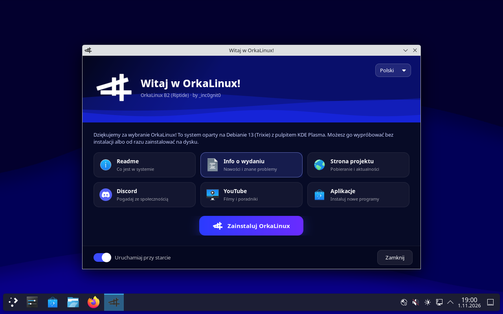
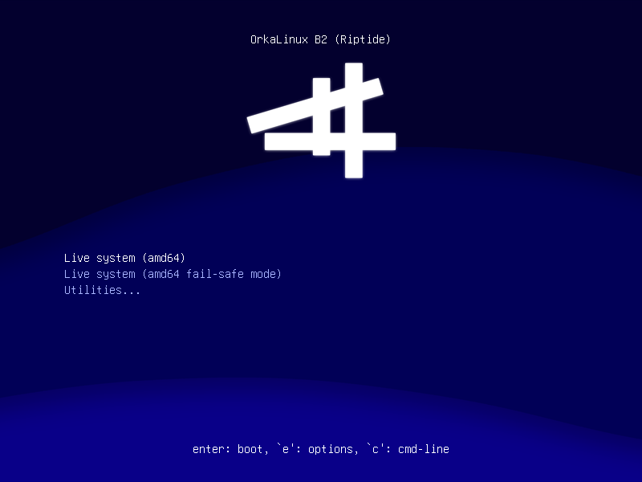
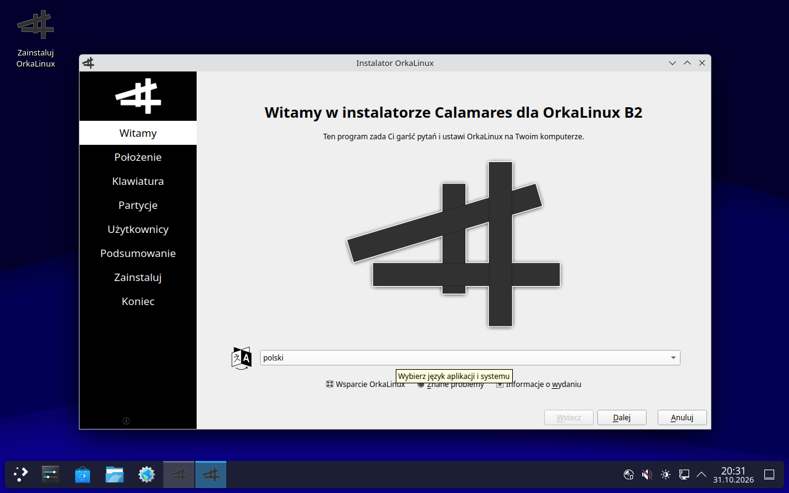
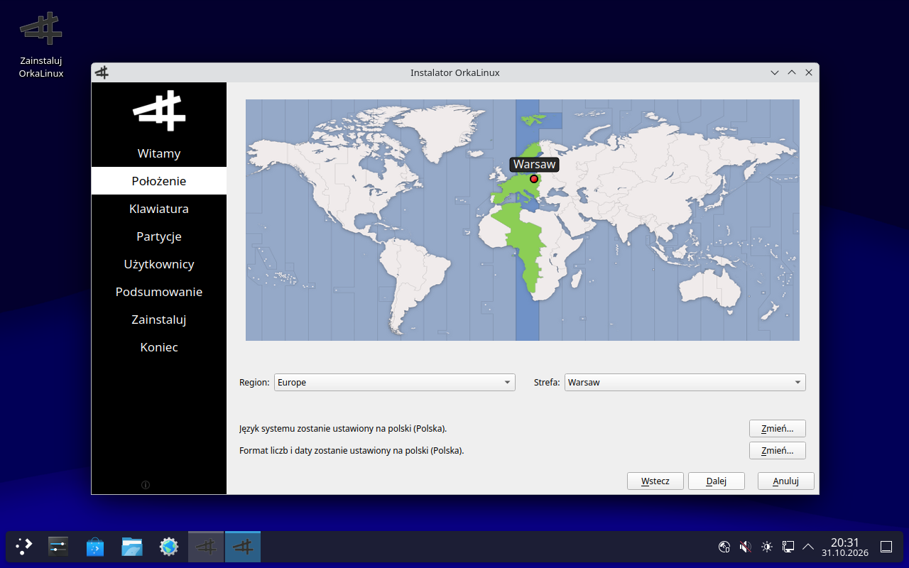
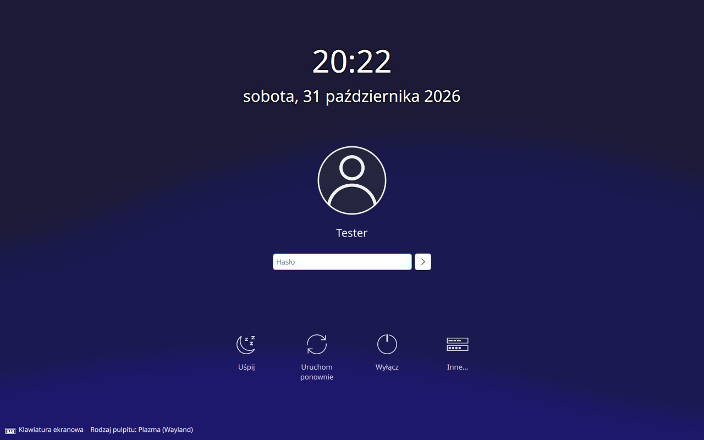

# OrkaLinux

A Linux distribution built on **Debian 13 (Trixie)** with the **KDE Plasma 6** desktop. It boots straight into a ready-to-use system: a browser, an office suite, a media player and Discord are already there, and a welcome app shows you around. Try it live from a USB stick, then install it with a few clicks.



**[Download the latest version](https://github.com/cyz-yt/OrkaLinux/releases/latest)** · [Website](https://cyzs-retroweb.rf.gd/orkalinux.php) · [Discord](https://discord.gg/JkC9P6ebN2) · [YouTube](https://www.youtube.com/@_inc0gnit0)

Current version: **B2 "Riptide"** (beta)

## What's inside

- **Debian 13 (Trixie)** with Linux 6.12, so it gets Debian's security updates
- **KDE Plasma 6.3**, Wayland or X11 session
- **Firefox**, **LibreOffice**, **VLC**, **Discord** and **Fastfetch**
- KDE apps: Dolphin, Konsole, Kate, Ark, Gwenview, Okular, Spectacle, KCalc, Partition Manager, System Monitor
- **Discover** with Flatpak, for installing more apps
- **OrkaLinux Hello**, a welcome app in Polish, English, German and French
- **Calamares** installer, which works without an internet connection
- Starts on UEFI computers with **Secure Boot turned on**, and on older BIOS computers
- Its own look: boot menu, boot splash, login screen, wallpapers

The system language is **Polish** by default. You can change it in System Settings > Region & Language.

## Screenshots

| | |
|---|---|
|  |  |
| The boot menu | Starting up |
|  |  |
| The Calamares installer | Picking your time zone |
|  | |
| The login screen | |

## Installing

The ISO is about 2.9 GB. GitHub only allows files up to 2 GB, so the download comes in two parts that you join back into one file.

**1. Download** both parts and `SHA256SUMS.txt` from [Releases](https://github.com/cyz-yt/OrkaLinux/releases/latest).

**2. Join the parts.** Put them in one folder, then:

- Windows, with [7-Zip](https://www.7-zip.org/): right-click the `.001` file, then **7-Zip > Combine files**.
- Windows, without 7-Zip: open Command Prompt in that folder and run

  ```
  copy /b OrkaLinux-B2-amd64.hybrid.iso.001 + OrkaLinux-B2-amd64.hybrid.iso.002 OrkaLinux-B2-amd64.hybrid.iso
  ```

- Linux:

  ```
  cat OrkaLinux-B2-amd64.hybrid.iso.001 OrkaLinux-B2-amd64.hybrid.iso.002 > OrkaLinux-B2-amd64.hybrid.iso
  ```

**3. Check the file.** The SHA-256 must match the one in `SHA256SUMS.txt`.

- Windows (PowerShell): `Get-FileHash OrkaLinux-B2-amd64.hybrid.iso`
- Linux: `sha256sum -c SHA256SUMS.txt --ignore-missing`

**4. Write it to a USB stick** (4 GB or bigger) with [Rufus](https://rufus.ie/), [balenaEtcher](https://etcher.balena.io/) or [Ventoy](https://www.ventoy.net/). If Rufus asks, pick **DD Image** mode.

**5. Boot from the stick** and choose **Live system**. Everything works without touching your disk. When you are ready, double-click **Zainstaluj OrkaLinux** (Install OrkaLinux) on the desktop, or use the same button in OrkaLinux Hello.

**Requirements:** a 64-bit PC (x86-64), 4 GB of RAM and 20 GB of disk space for the installed system.

## Building it yourself

The whole system is described by the files in this repository and built with Debian's `live-build`. See [BUILDING.md](BUILDING.md).

## Beta

OrkaLinux is a beta. If something does not work, tell us on [Discord](https://discord.gg/JkC9P6ebN2).

## Credits

- [Debian](https://www.debian.org/), [KDE](https://kde.org/), [Calamares](https://calamares.io/) and [live-build](https://salsa.debian.org/live-team/live-build)
- Wallpapers by Caterina Berger and mily_

## More from the same author

- [OrkaPlayer](https://github.com/cyz-yt/OrkaPlayer): a media player for Windows, built on the VLC engine, with lyrics that sing along.
- [OrkaNote](https://cyzs-retroweb.rf.gd/orkanote.php): a Notepad for Windows, lighter than the built-in one.
