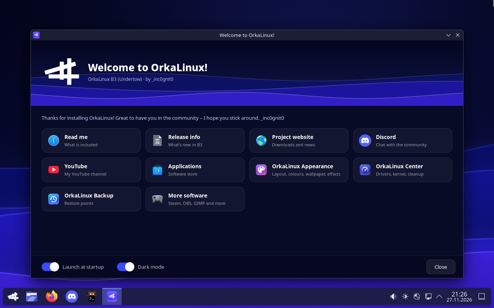
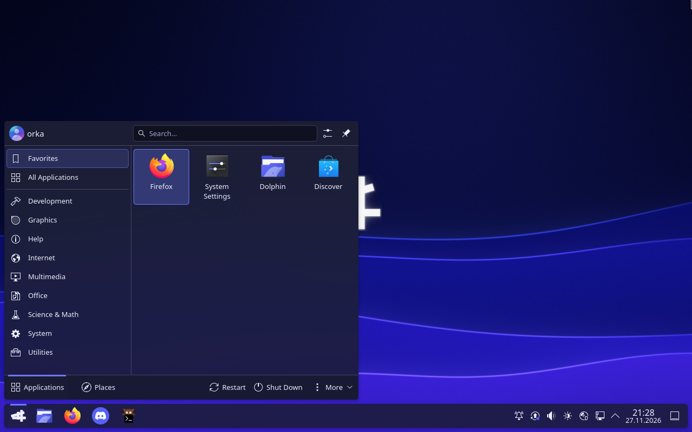
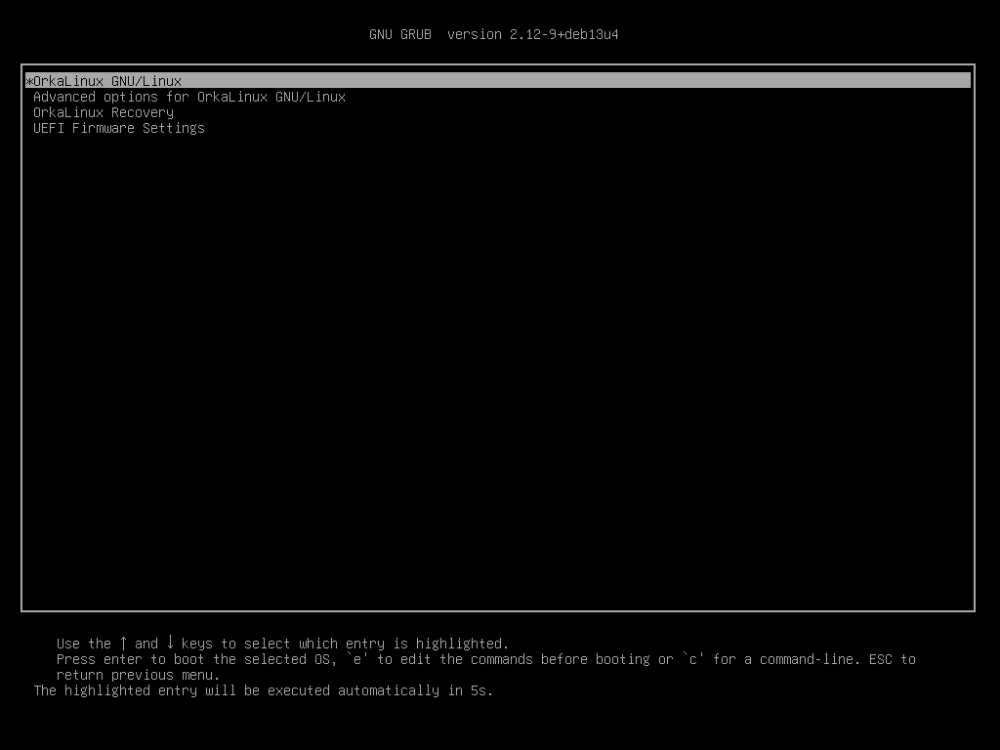
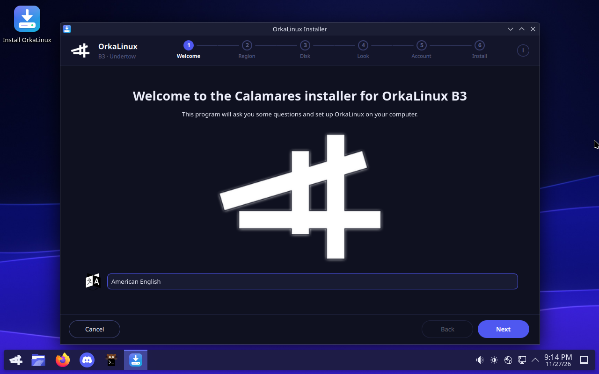
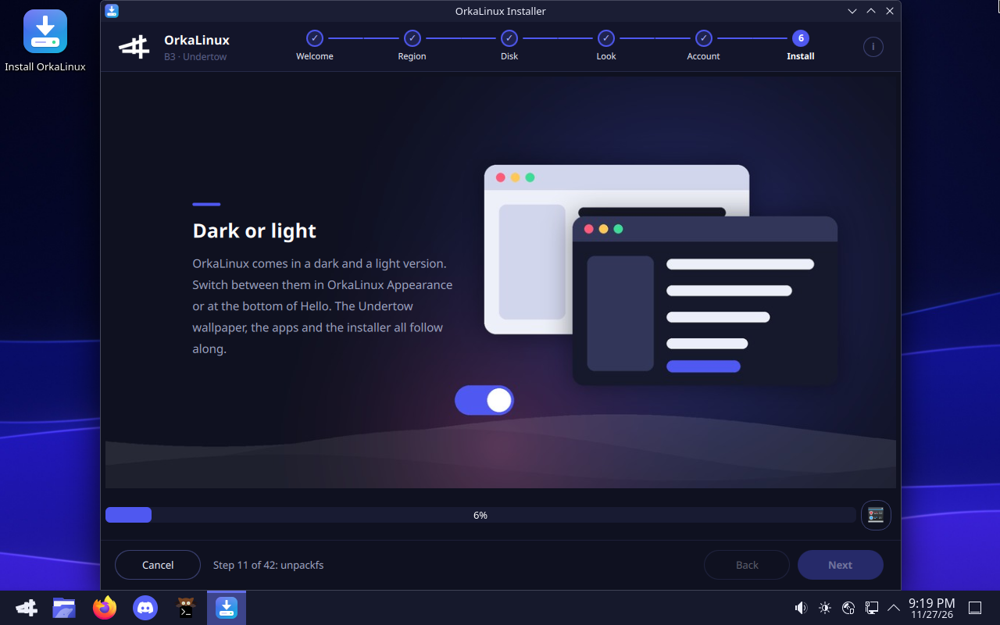
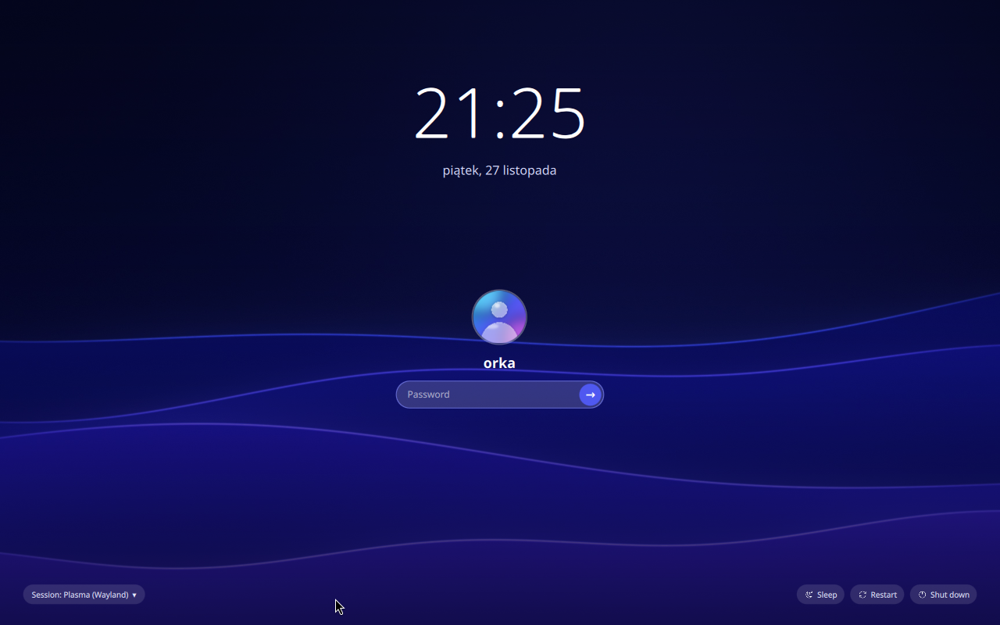
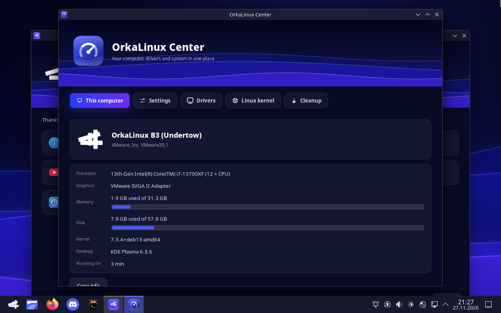
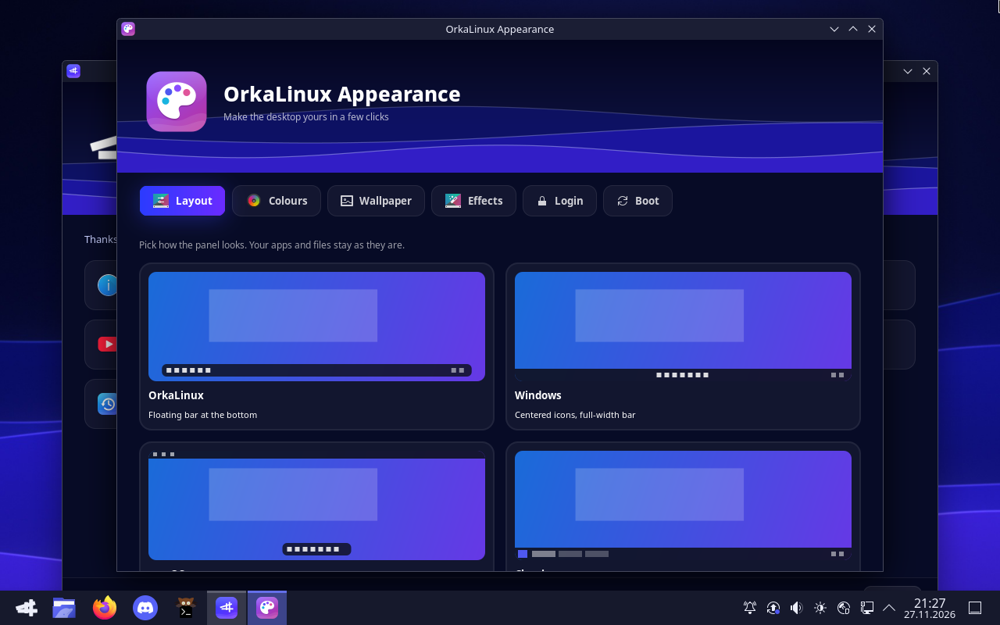
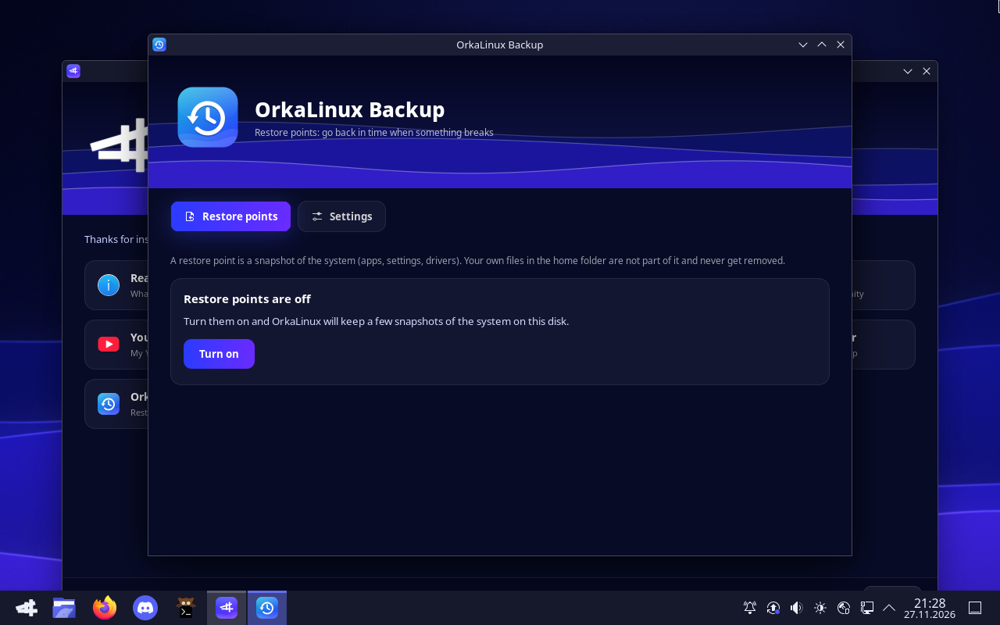
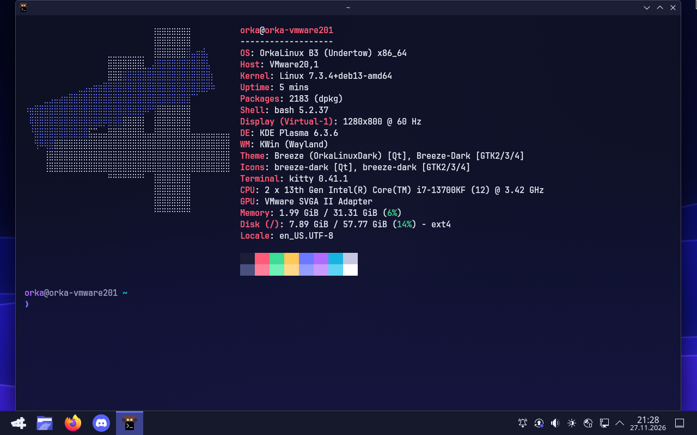

# OrkaLinux

A Linux distribution built on **Debian 13 (Trixie)** with the **KDE Plasma 6** desktop. It boots straight into a ready-to-use system: a browser, an office suite, a media player and Discord are already there, and a welcome app shows you around. Try it live from a USB stick, then install it with a few clicks.



**[Download the latest version](https://github.com/cyz-yt/OrkaLinux/releases/latest)** · [Website](https://cyzs-retroweb.rf.gd/orkalinux.php) · [Discord](https://discord.gg/JkC9P6ebN2) · [YouTube](https://www.youtube.com/@_inc0gnit0)

Current version: **B3 "Undertow"** (beta)

## What's inside

- **Debian 13 (Trixie)** with Linux 7.3 from backports, so it gets Debian's security updates
- **KDE Plasma 6.3**, Wayland or X11 session, a Windows 11 style taskbar, dark and light look
- **Firefox** (straight from Mozilla), **LibreOffice**, **VLC**, **Discord** (updates itself), **Fastfetch** and the **kitty** terminal
- KDE apps: Dolphin, Kate, Ark, Gwenview, Okular, Spectacle, KCalc, Partition Manager, System Monitor
- **Discover** with Flathub, plus **More software** in OrkaLinux Hello - Steam, OBS, GIMP and more in one click
- Orka apps:
  - **OrkaLinux Center** - NVIDIA drivers, Linux kernel, cleanup, updates, firewall
  - **OrkaLinux Appearance** - panel layout, colours, wallpaper, effects, login screen, boot screen
  - **OrkaLinux Backup** - restore points, made by hand or on a schedule
- **OrkaLinux Recovery** - a repair mode in the boot menu, like the one on Windows
- OrkaLinux updates come from its own repository, so fixes arrive without reinstalling
- **OrkaLinux Hello**, a welcome app in 8 languages
- **Calamares** installer, which works without an internet connection, with a choice of GRUB or systemd-boot
- Starts on UEFI computers with **Secure Boot turned on**, and on older BIOS computers

The system is in **English** by default. Pick **OrkaLinux B3 (Polski)** in the boot menu for Polish. The installer lets you set the system language, and Hello, the installer and the Orka apps follow it.

### Privacy and speed

- No telemetry - the system sends nothing about you and there is no account to create
- Firefox has telemetry and Mozilla studies turned off
- The firewall (ufw) is on from the first boot
- Debian security fixes install on their own (you can turn this off in OrkaLinux Center)
- zram instead of slow swap on disk, so older computers stutter less

### OrkaLinux Recovery

When something breaks, you don't have to reinstall right away. OrkaLinux Recovery is a separate entry in the boot menu and starts even when the desktop won't. It can:

- restore the system from a restore point (files in your home folder stay)
- repair software after an interrupted update
- repair startup (GRUB or systemd-boot)
- free up disk space
- reset the desktop look
- remove the NVIDIA driver when it leaves you with a black screen
- change a password or open a terminal (you can turn this off in OrkaLinux Center)

You can also get there from OrkaLinux Center, and the Restore button in OrkaLinux Backup restarts the computer and restores the system right there.

## Screenshots

| | |
|---|---|
|  |  |
| The start menu | The boot menu |
|  |  |
| Starting up | The installer |
|  |  |
| Installing, with what is going on at the bottom | The login screen |
|  |  |
| OrkaLinux Center | OrkaLinux Appearance |
|  |  |
| OrkaLinux Backup | kitty with Fastfetch |

## Installing

The ISO is about 3.4 GB. GitHub only allows files up to 2 GB, so the download comes in two parts that you join back into one file.

**1. Download** both parts and `SHA256SUMS.txt` from [Releases](https://github.com/cyz-yt/OrkaLinux/releases/latest).

**2. Join the parts.** Put them in one folder, then:

- Windows, with [7-Zip](https://www.7-zip.org/): right-click the `.001` file, then **7-Zip > Combine files**.
- Windows, without 7-Zip: open Command Prompt in that folder and run

  ```
  copy /b OrkaLinux-B3-amd64.hybrid.iso.001 + OrkaLinux-B3-amd64.hybrid.iso.002 OrkaLinux-B3-amd64.hybrid.iso
  ```

- Linux:

  ```
  cat OrkaLinux-B3-amd64.hybrid.iso.001 OrkaLinux-B3-amd64.hybrid.iso.002 > OrkaLinux-B3-amd64.hybrid.iso
  ```

**3. Check the file.** The SHA-256 must match the one in `SHA256SUMS.txt`.

- Windows (PowerShell): `Get-FileHash OrkaLinux-B3-amd64.hybrid.iso`
- Linux: `sha256sum -c SHA256SUMS.txt --ignore-missing`

**4. Write it to a USB stick** (8 GB or bigger) with [Rufus](https://rufus.ie/), [balenaEtcher](https://etcher.balena.io/) or [Ventoy](https://www.ventoy.net/). If Rufus asks, pick **DD Image** mode.

**5. Boot from the stick** and choose **OrkaLinux B3 (English)** or **OrkaLinux B3 (Polski)**. Everything works without touching your disk. When you are ready, double-click **Install OrkaLinux** on the desktop, or use the same button in OrkaLinux Hello.

**Requirements:** a 64-bit PC (x86-64), 4 GB of RAM and 20 GB of disk space (40 GB if you want restore points).

## Building it yourself

The whole system is described by the files in this repository and built with Debian's `live-build`. See [BUILDING.md](BUILDING.md).

## Beta

OrkaLinux is a beta. If something does not work, tell me on [Discord](https://discord.gg/JkC9P6ebN2).

## Credits

- [Debian](https://www.debian.org/), [KDE](https://kde.org/), [Calamares](https://calamares.io/), [Timeshift](https://github.com/linuxmint/timeshift) and [live-build](https://salsa.debian.org/live-team/live-build)
- Wallpapers by Caterina Berger and mily_

## More from the same author

- [OrkaPlayer](https://github.com/cyz-yt/OrkaPlayer): a media player with lyrics that sing along, karaoke, radio, TV and podcasts.
- [OrkaNote](https://github.com/cyz-yt/OrkaNote): a Notepad for Windows with tabs that come back, colours for code, Run (F9) for scripts and a dark theme.
- [OrkaPaint](https://github.com/cyz-yt/OrkaPaint): a drawing program for Windows - a bit more than plain Paint, with layers, selections and effects.
- [cyz's ISO Creator](https://github.com/cyz-yt/cyzs-ISO-Creator): makes an ISO file from a folder - for getting documents into a virtual machine without VMware Tools.
